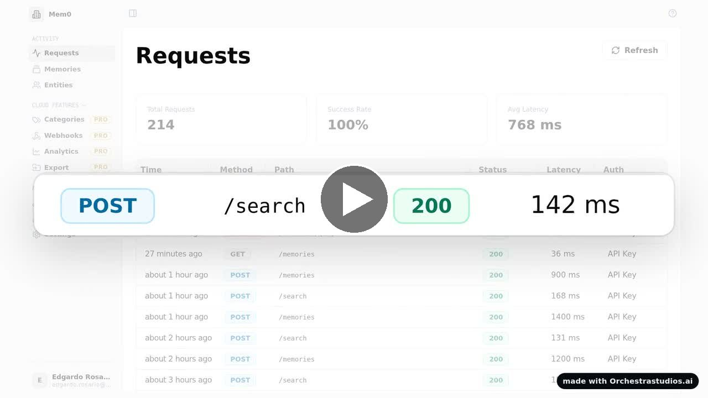
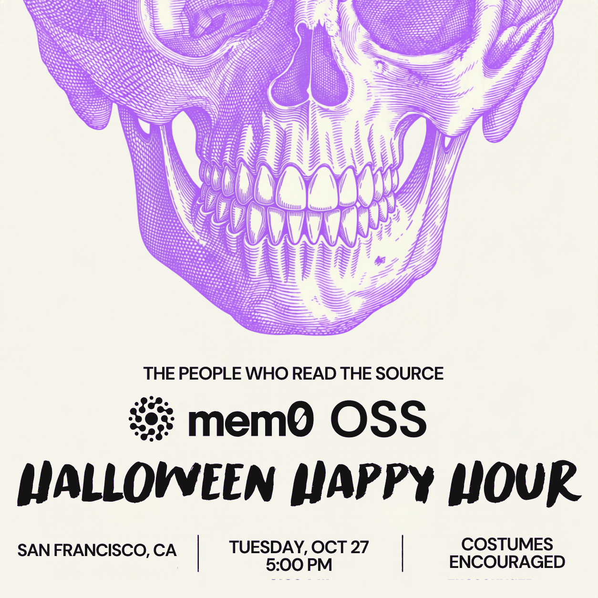

https://github.com/user-attachments/assets/da56ec63-f47b-4107-bc0f-389a52a34301

[](https://orchestrastudios.ai/films/mem0)

## 🎬 We made Mem0 a film

Hi Mem0 team — I'm Remy Tennant, founder of Orchestra Studios. This is a gift — a film we made specially for your company, directed from your product itself: your actual screens, in motion.

We're running a promotional campaign: **we're giving away 100 videos to YC companies over the next 30 days, first come, first served.** We came to you first because we admire Mem0's new memory algorithm — single-pass, ADD-only extraction with entity linking that jumped to 92.5 on LoCoMo and 94.4 on LongMemEval, and that you open-sourced the evaluation framework so anyone can reproduce the numbers. So we went ahead and made yours — the short film above. I think it came out great, and I'd love you to have it.

**Use it as-is, or claim it and get the real thing:**
- This copy is yours either way. Want just the video? Trim the outro card off the end and use it — no signup, no strings. It's 720p only because GitHub caps README videos at 10 MB; that's the whole reason, not a teaser.
- **Claim it at [orchestrastudios.ai/YC](https://orchestrastudios.ai/YC)** and you get the full 1080p master — plus the project itself, transferred to you the moment you sign up.
- Claiming means the film becomes *code you own*, not a file you're stuck with: edit any scene, line or voice, re-audition, re-render as often as you like. When your product changes, it can re-render from your code, so it never goes stale.
- Want changes? Just tell me what you'd fix — I'll hand it to the AI agent embedded in the project. It makes the edits and re-renders. First round's on us, no sweat.

**No strings attached.** No card, no sales call, no deadline on the gift itself — the film above is yours whether or not you ever claim the project. Why free? Orchestra just launched, and this is our launch campaign: we're giving a film to 100 YC companies, first come first served. We're YC founders ourselves, so we started with our own community — and a claimed project is worth more to us than a fee. That's the whole exchange.

Questions? Email me at **remy@orchestrastudios.ai**.

— Remy Tennant
Orchestra Studios

---

<p align="center">
  <a href="https://github.com/mem0ai/mem0">
    
  </a>
</p>

<p align="center">
  <a href="https://luma.com/mem0-oxfm">
    
  </a>
  <br>
  <a href="https://luma.com/mem0-oxfm"><strong>🎃 Register here →</strong></a> · Contributors get priority
</p>


<p align="center" style="display: flex; justify-content: center; gap: 20px; align-items: center;">
  <a href="https://trendshift.io/repositories/11194" target="blank">
    
  </a>
</p>

<p align="center">
  <a href="https://mem0.ai">Learn more</a>
  ·
  <a href="https://mem0.dev/DiG">Join Discord</a>
  ·
  <a href="https://mem0.dev/demo">Demo</a>
</p>

<p align="center">
  <a href="https://mem0.dev/DiG">
    
  </a>
  <a href="https://pepy.tech/project/mem0ai">
    
  </a>
  <a href="https://github.com/mem0ai/mem0">
    
  </a>
  <a href="https://pypi.org/project/mem0ai" target="blank">
    
  </a>
  <a href="https://www.npmjs.com/package/mem0ai" target="blank">
    
  </a>
  <a href="https://www.ycombinator.com/companies/mem0">
    
  </a>
</p>

<p align="center">
  <a href="https://mem0.ai/research"><strong>📄 Benchmarking Mem0's token-efficient memory algorithm →</strong></a>
</p>

## New Memory Algorithm (April 2026)

| Benchmark | Old | New  | Tokens  | Latency p50  |
| --- | --- | --- | --- | --- |
| **LoCoMo** | 71.4 | **92.5** | 7.0K  | 0.88s  |
| **LongMemEval** | 67.8 | **94.4** | 6.8K  | 1.09s  |
| **BEAM (1M)** | — | **64.1** | 6.7K  | 1.00s  |
| **BEAM (10M)** | — | **48.6** | 6.9K  | 1.05s  |

All benchmarks run on the same production-representative model stack. Single-pass retrieval (one call, no agentic loops) at a top_200 retrieval budget. Scores reflect Mem0's managed platform, which includes proprietary optimizations not available in the open-source SDK; open-source users should expect directionally similar gains but not identical numbers.

**What changed:**
- **Single-pass ADD-only extraction** -- one LLM call, no UPDATE/DELETE. Memories accumulate; nothing is overwritten.
- **Agent-generated facts are first-class** -- when an agent confirms an action, that information is now stored with equal weight.
- **Entity linking** -- entities are extracted, embedded, and linked across memories for retrieval boosting.
- **Multi-signal retrieval** -- semantic, BM25 keyword, and entity matching scored in parallel and fused.
- **Temporal Reasoning** -- time-aware retrieval that ranks the right dated instance for queries about current state, past events, and upcoming plans.

See the [migration guide](https://docs.mem0.ai/migration/oss-v2-to-v3) for upgrade instructions. The [evaluation framework](https://github.com/mem0ai/memory-benchmarks) is open-sourced so anyone can reproduce the numbers.

## Research Highlights
- **92.5 on LoCoMo** -- +21 points over the previous algorithm
- **94.4 on LongMemEval** -- +27 points, with 98.2 on assistant memory recall
- **64.1 on BEAM (1M)** -- production-scale memory evaluation at 1M tokens
- [Read the full paper](https://mem0.ai/research)

# Introduction

[Mem0](https://mem0.ai) ("mem-zero") enhances AI assistants and agents with an intelligent memory layer, enabling personalized AI interactions. It remembers user preferences, adapts to individual needs, and continuously learns over time—ideal for customer support chatbots, AI assistants, and autonomous systems.

### Key Features & Use Cases

**Core Capabilities:**
- **Multi-Level Memory**: Seamlessly retains User, Session, and Agent state with adaptive personalization
- **Developer-Friendly**: Intuitive API, cross-platform SDKs, and a fully managed service option

**Applications:**
- **AI Assistants**: Consistent, context-rich conversations
- **Customer Support**: Recall past tickets and user history for tailored help
- **Healthcare**: Track patient preferences and history for personalized care
- **Productivity & Gaming**: Adaptive workflows and environments based on user behavior

## 🚀 Quickstart Guide <a name="quickstart"></a>

### Sign up as an agent

AI agents can mint a working Mem0 API key in under five seconds — no email, no dashboard, no OTP. Four commands end-to-end:

```bash
# 1. Install
npm install -g @mem0/cli      # or: pip install mem0-cli

# 2. Sign up as an agent (replace `claude-code` with your name)
mem0 init --agent --agent-caller claude-code

# 3. Add a memory
mem0 add "I am using mem0"

# 4. Search
mem0 search "am I using mem0"
```

The human owner can claim the account later with `mem0 init --email <their-email>` — same key, memories preserved. Full guide: [Sign up as an agent](https://docs.mem0.ai/platform/agent-signup).

| | Library | Self-Hosted Server | Cloud Platform |
|---|---------|-------------------|----------------|
| **Best for** | Testing, prototyping | Teams running on their own infrastructure | Zero-ops production use |
| **Setup** | `pip install mem0ai` | `docker compose up` | Sign up at [app.mem0.ai](https://app.mem0.ai?utm_source=oss&utm_medium=readme) |
| **Dashboard** | -- | [Yes](https://docs.mem0.ai/open-source/setup) | Yes |
| **Auth & API Keys** | -- | Yes | Yes |
| **Advanced Features** | -- | Teasers | All included |

Just testing? Use the library. Building for a team? Self-hosted. Want zero ops? Cloud.

### Library (pip / npm)

```bash
pip install mem0ai
```

For enhanced hybrid search with BM25 keyword matching and entity extraction, install with NLP support:

```bash
pip install mem0ai[nlp]
python -m spacy download en_core_web_sm
```

Install sdk via npm:

```bash
npm install mem0ai
```

### Self-Hosted Server

> **Note:** Self-hosted auth is on by default. Upgrading from a pre-auth build? Set `ADMIN_API_KEY`, register an admin through the wizard, or `AUTH_DISABLED=true` for local dev only. See [upgrade notes](https://docs.mem0.ai/open-source/setup#upgrade-notes).

```bash
# Recommended: one command — start the stack, create an admin, issue the first API key.
cd server && make bootstrap

# Manual: start the stack and finish setup via the browser wizard.
cd server && docker compose up -d    # http://localhost:3000
```

See the [self-hosted docs](https://docs.mem0.ai/open-source/overview) for configuration.

### Cloud Platform

1. Sign up on [Mem0 Platform](https://app.mem0.ai?utm_source=oss&utm_medium=readme)
2. Embed the memory layer via SDK or API keys
3. Using hosted Qdrant vectors? See the [Platform migration guide](https://docs.mem0.ai/migration/oss-to-platform) to import them into Mem0 Platform.

### CLI

Manage memories from your terminal:

```bash
npm install -g @mem0/cli   # or: pip install mem0-cli

mem0 init
mem0 add "Prefers dark mode and vim keybindings" --user-id alice
mem0 search "What does Alice prefer?" --user-id alice
```

See the [CLI documentation](https://docs.mem0.ai/platform/cli) for the full command reference.

### Agent Skills

Teach your AI coding assistant (Claude Code, Codex, Cursor, Windsurf, OpenCode, OpenClaw, and any tool that supports the skills standard) how to build with Mem0. Two categories:

**Reference skills — always on** (SDK knowledge loaded into the assistant's context):

```bash
npx skills add https://github.com/mem0ai/mem0 --skill mem0
npx skills add https://github.com/mem0ai/mem0 --skill mem0-cli
npx skills add https://github.com/mem0ai/mem0 --skill mem0-vercel-ai-sdk
```

**Pipeline skills — run on demand** (execute an end-to-end workflow in an existing repo):

```bash
npx skills add https://github.com/mem0ai/mem0 --skill mem0-integrate
npx skills add https://github.com/mem0ai/mem0 --skill mem0-test-integration
npx skills add https://github.com/mem0ai/mem0 --skill mem0-oss-to-platform
```

Use `/mem0-integrate` to wire Mem0 into an existing repo via a test-first pipeline, then `/mem0-test-integration` to verify. Use `/mem0-oss-to-platform` to migrate an existing project from Mem0 OSS to the hosted Platform SDK. See the [skills catalog](./skills/) or [Vibecoding with Mem0](https://docs.mem0.ai/vibecoding) for the full picture.

### Basic Usage

Mem0 requires an LLM to function, with `gpt-5-mini` from OpenAI as the default. However, it supports a variety of LLMs; for details, refer to our [Supported LLMs documentation](https://docs.mem0.ai/components/llms/overview).

Mem0 uses `text-embedding-3-small` from OpenAI as the default embedding model. For best results with hybrid search (semantic + keyword + entity boosting), we recommend using at least [Qwen 600M](https://huggingface.co/Alibaba-NLP/gte-Qwen2-1.5B-instruct) or a comparable embedding model. See [Supported Embeddings](https://docs.mem0.ai/components/embedders/overview) for configuration details.

First step is to instantiate the memory:

```python
from openai import OpenAI
from mem0 import Memory

openai_client = OpenAI()
memory = Memory()

def chat_with_memories(message: str, user_id: str = "default_user") -> str:
    # Retrieve relevant memories
    relevant_memories = memory.search(query=message, filters={"user_id": user_id}, top_k=3)
    memories_str = "\n".join(f"- {entry['memory']}" for entry in relevant_memories["results"])

    # Generate Assistant response
    system_prompt = f"You are a helpful AI. Answer the question based on query and memories.\nUser Memories:\n{memories_str}"
    messages = [{"role": "system", "content": system_prompt}, {"role": "user", "content": message}]
    response = openai_client.chat.completions.create(model="gpt-5-mini", messages=messages)
    assistant_response = response.choices[0].message.content

    # Create new memories from the conversation
    messages.append({"role": "assistant", "content": assistant_response})
    memory.add(messages, user_id=user_id)

    return assistant_response

def main():
    print("Chat with AI (type 'exit' to quit)")
    while True:
        user_input = input("You: ").strip()
        if user_input.lower() == 'exit':
            print("Goodbye!")
            break
        print(f"AI: {chat_with_memories(user_input)}")

if __name__ == "__main__":
    main()
```

For detailed integration steps, see the [Quickstart](https://docs.mem0.ai/quickstart) and [API Reference](https://docs.mem0.ai/api-reference).

## 🔗 Integrations & Demos

- **ChatGPT with Memory**: Personalized chat powered by Mem0 ([Live Demo](https://mem0.dev/demo))
- **Browser Extension**: Store memories across ChatGPT, Perplexity, and Claude ([Chrome Extension](https://chromewebstore.google.com/detail/onihkkbipkfeijkadecaafbgagkhglop?utm_source=item-share-cb))
- **Langgraph Support**: Build a customer bot with Langgraph + Mem0 ([Guide](https://docs.mem0.ai/integrations/langgraph))
- **CrewAI Integration**: Tailor CrewAI outputs with Mem0 ([Example](https://docs.mem0.ai/integrations/crewai))

## 📚 Documentation & Support

- Full docs: https://docs.mem0.ai
- Community: [Discord](https://mem0.dev/DiG) · [X (formerly Twitter)](https://x.com/mem0ai)
- Contact: founders@mem0.ai

## Citation

We now have a paper you can cite:

```bibtex
@article{mem0,
  title={Mem0: Building Production-Ready AI Agents with Scalable Long-Term Memory},
  author={Chhikara, Prateek and Khant, Dev and Aryan, Saket and Singh, Taranjeet and Yadav, Deshraj},
  journal={arXiv preprint arXiv:2504.19413},
  year={2025}
}
```

## ⚖️ License

Apache 2.0 — see the [LICENSE](https://github.com/mem0ai/mem0/blob/main/LICENSE) file for details.
